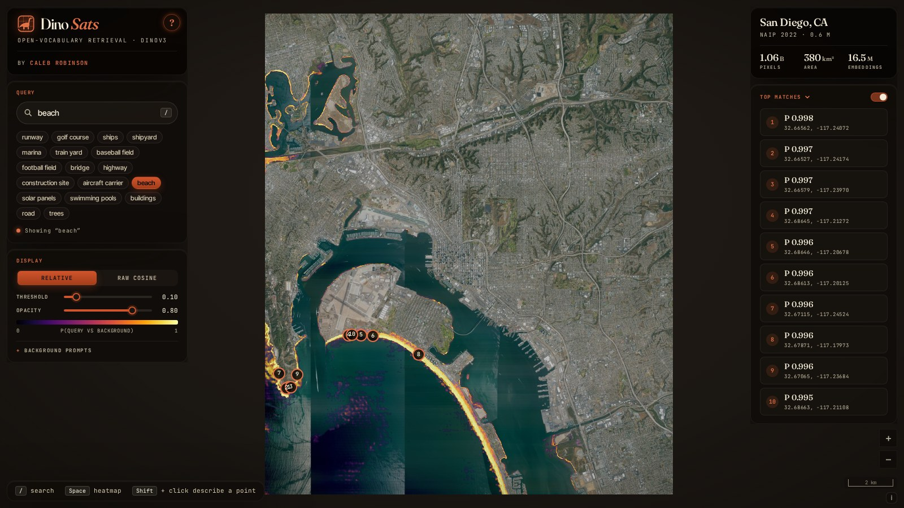

# DinoSats — Open-Vocabulary Search over Aerial Imagery

**Jump to: [Quick start](#quick-start) | [How it works](#how-it-works) | [Pipeline](#pipeline) | [Web app](#web-app) | [Configuration](#configuration) | [Hosting](#hosting) | [Files](#files) | [Data and models](#data-and-models) | [Citation](#citation) | [License](#license)**

Type what you're looking for (*runway*, *marina*, *solar panels*, *aircraft carrier*) and DinoSats maps where it is across a billion pixels of aerial imagery, live in the browser. Image patch embeddings from Meta's [DINOv3](https://github.com/facebookresearch/dinov3) ViT-L/16 are precomputed offline, and the [dino.txt](https://arxiv.org/abs/2412.16334) text encoder that is aligned with them runs client-side with onnxruntime-web, so any free-text prompt can be scored against every patch with no backend.

This repo provides:

1. A **Python pipeline** that downloads NAIP quarter quads from the [Microsoft Planetary Computer](https://planetarycomputer.microsoft.com/dataset/naip), mosaics them, embeds them with DINOv3 into a 64-band uint8 PCA Cloud-Optimized GeoTIFF, and exports the dino.txt text encoder to an 8-bit ONNX model
2. A **static web app** ([`web/`](web/)) built on OpenLayers + geotiff.js + onnxruntime-web (WebGPU or multi-threaded WebAssembly) that streams the embeddings, encodes prompts and renders the heatmap

ℹ️ The hosted demo at **[calebrob.com/dinosats](https://calebrob.com/dinosats/)** covers 380 km² of San Diego (a 3 × 3 mosaic of 2022 NAIP quarter quads at 0.6 m: 1.06 B pixels, 16.5 M embeddings at 4.8 m). The embeddings, imagery and text encoder are hosted on [Source Cooperative](https://source.coop/calebrob6/geospatialml); this repo lets you rebuild them for any NAIP area.

<p align="center">
  <a href="https://calebrob.com/dinosats/"></a>
</p>

**Figure 1.** DinoSats over San Diego (NAIP 2022) for the prompt *beach*. The heatmap is the per-patch probability of the prompt against a set of background prompts (*buildings*, *road*, *water*, …). The ocean beaches of Coronado and the Silver Strand light up as a thin line, along with the shores of Mission Bay, and the top ten matches are on Coronado's beaches and the tip of Point Loma.

dino.txt was trained to align DINOv3 features with captions of web photos, not aerial imagery, so this is zero-shot. It works well for things that are distinctive at a few metres per patch (runways, golf courses, marinas, ships, sports fields) and less well for small or ambiguous objects, and scores are only meaningful relative to the background prompts. Treat it as an exploration tool: a fast way to see what open-vocabulary features can find in a scene before training anything.

## Quick start

The fastest way to try DinoSats is the hosted demo, with no install:

> 👉 **[calebrob.com/dinosats](https://calebrob.com/dinosats/)**: open-vocabulary search over San Diego, NAIP 2022.

The first prompt that isn't in the precomputed vocabulary downloads the 664 MB text encoder, which the browser caches for later visits. The example chips work immediately.

To run the app locally against the same hosted data:

```bash
git clone https://github.com/calebrob6/dinosats.git
cd dinosats
npm install
npm run build      # bundles OpenLayers/geotiff/proj4 and copies onnxruntime-web and coi-serviceworker into web/
python3 serve.py   # serves web/ at http://localhost:8766/ with cross-origin isolation headers
```

Browsers only allow the service worker, Cache API and cross-origin isolation on `localhost` or https, so on a remote machine forward the port (`ssh -L 8766:localhost:8766 <host>`). To build your own scene, follow the [Pipeline](#pipeline).

## How it works

1. **Embedding (offline).** [`scripts/embed.py`](scripts/embed.py) upsamples the NAIP mosaic 2× and runs DINOv3 ViT-L/16 over 1024 px windows with a 256 px stride, so each 1024-d patch token covers 4.8 m. Overlapping windows are blended with a Hann weight, which removes seams between windows. PCA reduces the tokens to 64 components, which are quantised to uint8 and written as a tiled COG with block-averaged overviews (averaging the codes equals averaging the dequantised embeddings because dequantisation is affine).
2. **Text encoding (in the browser).** A prompt goes through a JavaScript port of the CLIP BPE tokenizer and the dino.txt text encoder, exported to an 8-bit quantised ONNX model. It runs on WebGPU when its output matches PyTorch's (cosine > 0.999 on a bundled self-check), and otherwise on multi-threaded WebAssembly in a worker, at about 0.5 s per prompt on 8 threads. The model is stored with the Cache API under its SHA-256, so it is only downloaded again when it changes. About 900 land-cover and object strings, the example chips and the background prompts are precomputed by [`scripts/embed_vocab.py`](scripts/embed_vocab.py), so those need no encoder at all.
3. **Scoring.** The half of the text embedding that is aligned with patch tokens is L2-normalised and projected through the same PCA, so its cosine with a token is a 64-d dot product on the uint8 codes: `cos(t, x) ≈ t · mean + (C t) · z`. Raw single-prompt cosines are noisy and hard to threshold, so by default each token shows a softmax of the query against the background prompts (with dino.txt's logit scale of 100). Raw cosine is one click away.
4. **Level-of-detail streaming.** The app downloads the finest COG overview with at most 2.5 M tokens (the 19.2 m level, about 1 M tokens and 51 MB for San Diego) and scores it for every query; that drives the scene-wide heatmap and top matches. A 38.4 m level (13 MB) loads first, so the app is usable within a few seconds. When you zoom in, it streams the 256 × 256-token blocks (2–3 MB each) of a finer level that cover the view, centre first, and scores each one as it arrives: 9.6 m tokens, then 4.8 m once they are less than 3 screen pixels wide. Small objects are diluted at 19.2 m, so they appear when you zoom in but may be missed by the scene-wide top matches.

DINOv3 patch features depend on their position in the window. At a 512 px stride this shows up on flat content as a pattern repeating every window stride (open ocean scoring in 300 m blobs for "boats"), which a 256 px stride removes, at 4× the compute. The app also removes the positional bias by default, following [INSID3](https://github.com/visinf/INSID3): `embed.py` embeds a blank image, and the top 500 singular vectors of its patch tokens span a positional subspace that is projected out of both the query and the tokens before taking the cosine. Only the query needs projecting (the projection is symmetric), and each token's norm after the projection is a 65 × 65 quadratic form on its PCA codes, precomputed for the scene-wide level (`?debias=0` turns it off).

## Pipeline

```text
download_naip.py         NAIP quarter quads from the Planetary Computer (STAC search + azcopy)
        │
        ▼
 make_mosaic.py          Lossless GeoTIFF for embedding + JPEG RGB COG for display
        │
        ▼
    embed.py             DINOv3 patch tokens → 64-band uint8 PCA COG + .pca.json (+ positional basis)
        │
        ▼
 embed_vocab.py          Precomputed text embeddings for reverse lookup and the example chips
        │
        ▼
export_text_encoder.py   dino.txt text encoder → 8-bit ONNX for the browser (+ .sha256 and self-check)
```

### Setup

The pipeline needs a CUDA GPU, Python 3.12 and [azcopy](https://learn.microsoft.com/azure/storage/common/storage-use-azcopy-v10). The DINOv3 backbone is gated on Hugging Face, so request access to [facebook/dinov3-vitl16-pretrain-lvd1689m](https://huggingface.co/facebook/dinov3-vitl16-pretrain-lvd1689m) first.

```bash
python3 -m venv .venv && .venv/bin/pip install -r requirements.txt
git clone https://github.com/facebookresearch/dinov3.git   # Meta's model code, imported by scripts/dinotxt.py

.venv/bin/hf auth login
.venv/bin/hf download facebook/dinov3-vitl16-pretrain-lvd1689m --local-dir weights/hf-dinov3-vitl16-lvd1689m
.venv/bin/hf download PIA-SPACE-LAB/dinov3_vitl16_dinotxt_vision_head_and_text_encoder \
    dinov3_vitl16_dinotxt_vision_head_and_text_encoder-a442d8f5.pth --local-dir weights
curl -L -o weights/bpe_simple_vocab_16e6.txt.gz https://dl.fbaipublicfiles.com/dinov3/thirdparty/bpe_simple_vocab_16e6.txt.gz
```

Meta distributes the dino.txt head and text encoder through the download form linked from the [dinov3 repo](https://github.com/facebookresearch/dinov3#pretrained-heads---zero-shot-tasks-with-dinotxt); the Hugging Face copy above is a mirror of the same file (its SHA-256 starts with `a442d8f5`, as in Meta's file name). [`scripts/dinotxt.py`](scripts/dinotxt.py) maps the Hugging Face backbone weights onto Meta's model code.

### San Diego walkthrough

```bash
# 1. Download nine 2022 NAIP quarter quads into data/naip/
.venv/bin/python scripts/download_naip.py 3211715_sw 3211715_se 3211716_sw 3211723_nw 3211723_ne 3211724_nw 3211723_sw 3211723_se 3211724_sw --year 2022 --state ca

# 2. Mosaic them, cropped to the inner rectangle
.venv/bin/python scripts/make_mosaic.py data/naip/*.tif --out data/naip_2022_san_diego_3x3.tif --web_out web/data/naip_2022_san_diego_3x3_rgb.tif

# 3. Embed at 2× (4.8 m tokens) with a 256 px stride, spreading windows over two GPUs (about an hour on two GPUs, ~34 GB RAM)
.venv/bin/python scripts/embed.py --input_fn data/naip_2022_san_diego_3x3.tif --output_fn web/data/naip_2022_san_diego_3x3_dinotxt_pca64_2x_s256.tif --resize_factor 2 --device cuda:0,cuda:1

# 4. Embed scripts/vocab.txt plus the background prompts and example chips from web/config.json
.venv/bin/python scripts/embed_vocab.py

# 5. Export the text encoder to web/models/ (also rewrites web/selfcheck.json)
.venv/bin/python scripts/export_text_encoder.py

# 6. Point a config at the local files and open http://localhost:8766/?config=data/local.json
sed 's#https://s3.us-west-2.amazonaws.com/us-west-2.opendata.source.coop/calebrob6/geospatialml/dinosats/##' web/config.json > web/data/local.json
python3 serve.py
```

Quarter quads are named `<1° cell><7.5′ quad number>_<nw|ne|sw|se>`. Quads are numbered 1 to 64 row by row from the north-west corner of the 1° cell, so the neighbours of quad 23 are 15 (north), 22 and 24 (west and east) and 31 (south). `embed.py` keeps the full-resolution features on the CPU in fp16, so memory scales with the scene. Run any script with `--help` for its options.

## Web app

On first load a help tour introduces the app, with the scene's area, pixel count and the size of the embeddings on disk. The **?** button in the title card reopens it, and "Don't show this on startup" skips it on later visits.

- **Search**: type a prompt (`/` focuses the box) or click an example chip. Switch on **Top matches** to list the 10 highest-scoring places, and click one to fly there.
- **Display**: switch between the relative score and raw cosine, and set the threshold and opacity. `Space` shows or hides the heatmap.
- **Background prompts**: the prompts the query is scored against, editable under the Display card. Searching for a background prompt itself switches to raw cosine (with a note), and the next query switches back.
- **Describe a point**: `Shift` + click lists the 10 strings whose embeddings best match that location's token, from the precomputed vocabulary plus everything typed this session.

### URL parameters

| Parameter         | Description                                                                                              |
|:------------------|:---------------------------------------------------------------------------------------------------------|
| `?config=<url>`   | Load another config (default `config.json`), resolved against the page                                  |
| `?debug=true`     | Show developer controls: NAIP imagery and positional-bias toggles, and a timing bar                      |
| `?debias=0`       | Keep the positional bias (it is removed by default, [INSID3](https://github.com/visinf/INSID3)-style)     |
| `?ep=wasm`        | Force the WebAssembly backend (`?ep=webgpu` tries WebGPU first, the default when `shader-f16` is available) |
| `?coi=0`          | Skip the cross-origin isolation service worker (single-threaded wasm, about 2 s per prompt)              |
| `?proxy=0`        | Run wasm inference on the main thread instead of a worker                                                 |

## Configuration

The scene, model and prompt lists come from [`web/config.json`](web/config.json). Paths are resolved against the page, so they can be relative to `web/` or absolute URLs on another host.

| Field                     | Required | Description                                                                                         |
|:--------------------------|:--------:|:----------------------------------------------------------------------------------------------------|
| `scene.name`              |    ✓     | Place name shown in the scene card and help                                                         |
| `scene.subtitle`          |          | Imagery label, e.g. `NAIP 2022`                                                                     |
| `scene.rgb`               |    ✓     | RGB COG for display (`make_mosaic.py --web_out`)                                                    |
| `scene.embeddings`        |    ✓     | 64-band uint8 PCA COG (`embed.py --output_fn`)                                                      |
| `scene.pca`               |    ✓     | PCA model written next to the COG (`<name>.pca.json`)                                               |
| `scene.posbasis`          |          | Positional subspace (`<name>.posbasis.bin`); without it the positional bias is kept                 |
| `scene.posnorm`           |          | Precomputed debiased norms for the global level (`<name>.posnorm.bin`), so it needs no computing     |
| `scene.max_global_tokens` |          | Token budget of the scene-wide level (default `2500000`)                                            |
| `model`                   |    ✓     | ONNX text encoder; `<model>.sha256` next to it, if present, is the browser cache key                |
| `vocab`                   |    ✓     | CLIP BPE vocabulary (`bpe_simple_vocab_16e6.txt`)                                                   |
| `background`              |    ✓     | Background prompts for the relative score                                                           |
| `examples`                |    ✓     | Example chips under the search box                                                                  |
| `point_vocab.strings`     |          | `vocab.json` from `embed_vocab.py` (reverse lookup and encoder-free prompts)                         |
| `point_vocab.embeddings`  |          | `vocab_embeddings.bin` from `embed_vocab.py`                                                        |

## Hosting

The app is a static site. The code (46 MB once built, mostly onnxruntime-web's WebAssembly binaries) is deployed to GitHub Pages by [`.github/workflows/pages.yml`](.github/workflows/pages.yml) on every push to `main`, which runs `npm ci && npm run build` and publishes `web/`. GitHub Pages caps files at 100 MB, so the data and model live on [Source Cooperative](https://source.coop/calebrob6/geospatialml) under `calebrob6/geospatialml/dinosats/`:

| Path                                                             | Size    | Contents                                                       |
|:-----------------------------------------------------------------|--------:|:---------------------------------------------------------------|
| `data/naip_2022_san_diego_3x3_rgb.tif`                           | 403 MB  | JPEG RGB COG                                                   |
| `data/naip_2022_san_diego_3x3_dinotxt_pca64_2x_s256.tif`         | 1.09 GB | 64-band uint8 PCA embedding COG                                |
| `data/naip_2022_san_diego_3x3_dinotxt_pca64_2x_s256.pca.json`    | 0.8 MB  | PCA model                                                      |
| `data/…posbasis.bin`, `data/…posnorm.bin`                        | 6 MB    | Positional basis and norms                                     |
| `data/vocab.json`, `data/vocab_embeddings.bin`                   | 2 MB    | Precomputed vocabulary                                         |
| `models/text_encoder.onnx` (+ `.sha256`)                         | 664 MB  | 8-bit dino.txt text encoder                                    |
| `models/bpe_simple_vocab_16e6.txt`                               | 3.2 MB  | CLIP BPE vocabulary                                            |
| `models/LICENSE-DINOv3.md`                                       |         | License of the model weights                                   |

Visitors download about 64 MB of embeddings to start (the 38.4 m and 19.2 m levels), plus 2–3 MB per streamed block and the RGB tiles they look at. To upload a new scene, use the S3 API with Source Cooperative credentials, starting with a dry run so nothing is overwritten unintentionally:

```bash
aws s3 sync web/data   s3://calebrob6/geospatialml/dinosats/data/   --endpoint-url https://data.source.coop --dryrun
aws s3 sync web/data   s3://calebrob6/geospatialml/dinosats/data/   --endpoint-url https://data.source.coop
aws s3 sync web/models s3://calebrob6/geospatialml/dinosats/models/ --endpoint-url https://data.source.coop
```

The config uses the direct S3 URLs (`https://s3.us-west-2.amazonaws.com/us-west-2.opendata.source.coop/calebrob6/...`), which respond faster than `data.source.coop` and are cacheable. Any other host works if it:

- serves over https and supports HTTP Range requests, because geotiff.js and OpenLayers read the COGs block by block;
- for a different origin from the app, sends `Access-Control-Allow-Origin` and exposes `Content-Range` (`Access-Control-Expose-Headers`).

Multi-threaded WebAssembly needs cross-origin isolation (`Cross-Origin-Opener-Policy: same-origin`, `Cross-Origin-Embedder-Policy: require-corp`). Hosts that can't set headers, like GitHub Pages, get them from `web/coi-serviceworker.js`, which costs one automatic reload on the first visit. `python3 serve.py --no-isolation` mimics such a host.

`node scripts/smoke_test.mjs [url] [screenshot.png]` runs a headless end-to-end check against a running copy (default `http://localhost:8766/`; needs `npx playwright install chromium`): it steps through the help tour, runs queries with and without the text encoder, checks the background-prompt switch and the `Space` toggle, then zooms to the top match and checks that full-resolution blocks streamed.

## Files

- [`web/`](web/): the app. `index.html` and `style.css` (layout), `app.js` (map, streaming, scoring and UI), `search.js` (PCA projection, scoring and vocabulary lookup), `tokenizer.js` (CLIP BPE tokenizer), `tour.js` (help tour), `config.json`, and `selfcheck.json` (reference embeddings for the WebGPU check). `npm run build` adds `vendor/` and `coi-serviceworker.js`; local scene data goes in the git-ignored `data/` and `models/`.
- [`scripts/download_naip.py`](scripts/download_naip.py): finds NAIP quarter quads for a year and state on the Planetary Computer and downloads them with azcopy.
- [`scripts/make_mosaic.py`](scripts/make_mosaic.py): mosaics tiles into a lossless GeoTIFF and an optional JPEG RGB COG.
- [`scripts/embed.py`](scripts/embed.py): windowed DINOv3 embedding, PCA and COG writing (adapted from [interactive-semantic-segmentation](https://github.com/calebrob6/interactive-semantic-segmentation)). `--basis_only` writes just the positional basis for an existing scene.
- [`scripts/embed_vocab.py`](scripts/embed_vocab.py), [`scripts/vocab.txt`](scripts/vocab.txt): the precomputed vocabulary.
- [`scripts/export_text_encoder.py`](scripts/export_text_encoder.py): ONNX export and quantisation (`--quant q8|q4|fp32`), checked against PyTorch.
- [`scripts/dinotxt.py`](scripts/dinotxt.py): loads dino.txt in PyTorch.
- [`scripts/build_web.mjs`](scripts/build_web.mjs), [`scripts/smoke_test.mjs`](scripts/smoke_test.mjs), [`serve.py`](serve.py): build, test and local server.

## Data and models

- **Imagery**: [NAIP](https://planetarycomputer.microsoft.com/dataset/naip) (USDA Farm Service Agency) via the Microsoft Planetary Computer; public domain.
- **DINOv3 and dino.txt**: [facebookresearch/dinov3](https://github.com/facebookresearch/dinov3) (ViT-L/16 LVD-1689M backbone with the dino.txt vision head and text encoder), released under the [DINOv3 License](https://ai.meta.com/resources/models-and-libraries/dinov3-license/). The hosted ONNX text encoder and the embeddings are derived from these weights and are covered by the same license, a copy of which is next to the model on Source Cooperative.
- **Tokenizer**: the CLIP BPE vocabulary, redistributed by Meta under its [MIT license](https://dl.fbaipublicfiles.com/dinov2/thirdparty/LICENSE).
- **Positional debiasing**: [INSID3](https://github.com/visinf/INSID3).

## Citation

If you use this repo, please cite it, along with [DINOv3](https://github.com/facebookresearch/dinov3#citing-dinov3) and [dino.txt](https://arxiv.org/abs/2412.16334):

```bibtex
@misc{robinson2026dinosats,
  author       = {Robinson, Caleb},
  title        = {{DinoSats}: open-vocabulary search over aerial imagery in the browser},
  year         = {2026},
  howpublished = {\url{https://github.com/calebrob6/dinosats}}
}
```

## License

The code is MIT licensed (see [`LICENSE`](LICENSE)). The DINOv3 weights and everything derived from them are under the DINOv3 License.
